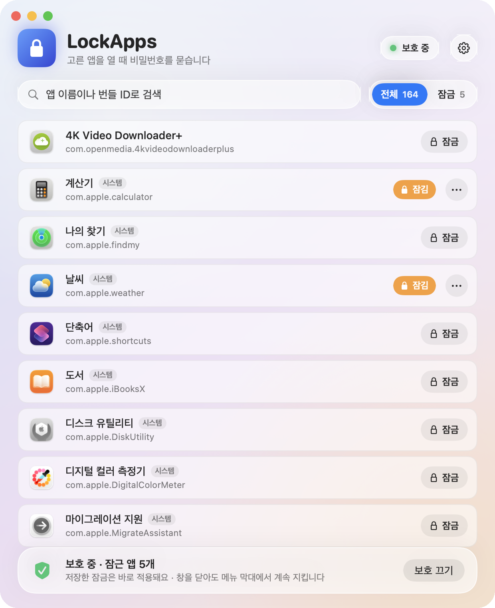
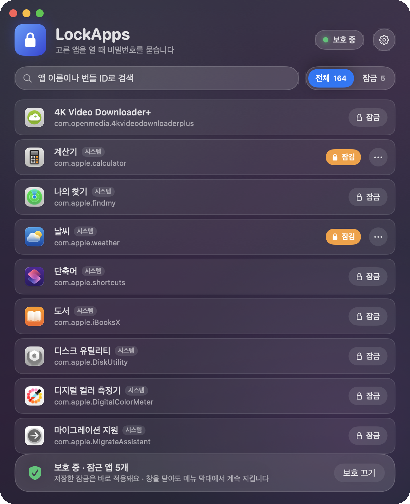
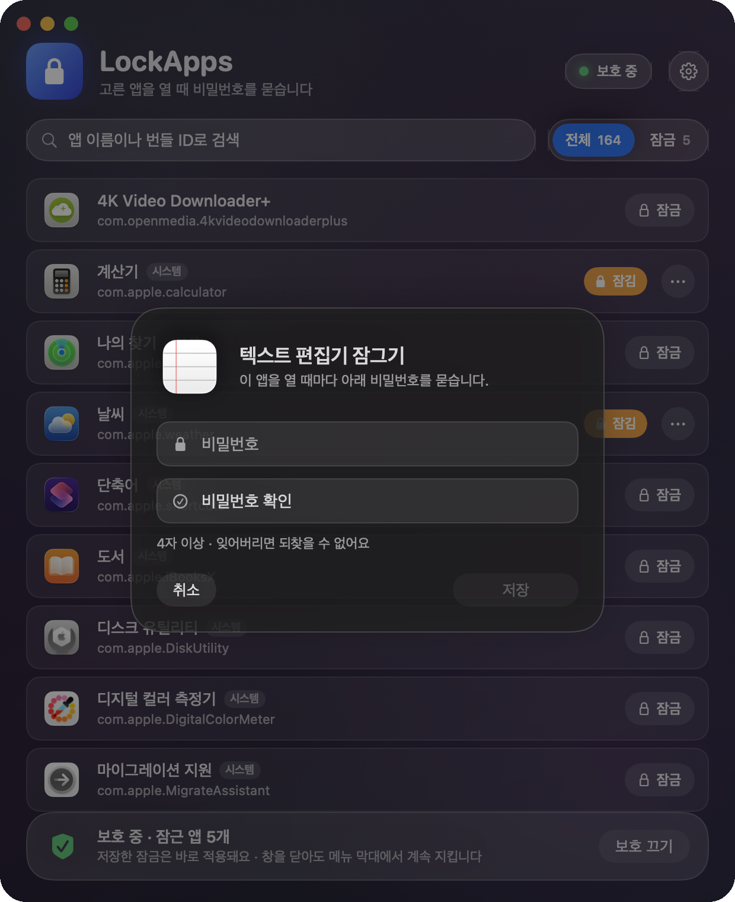
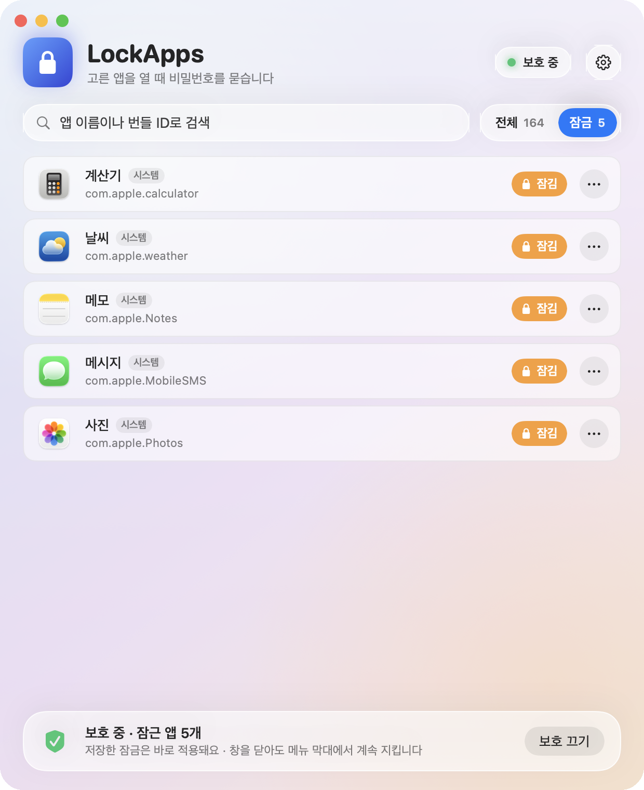
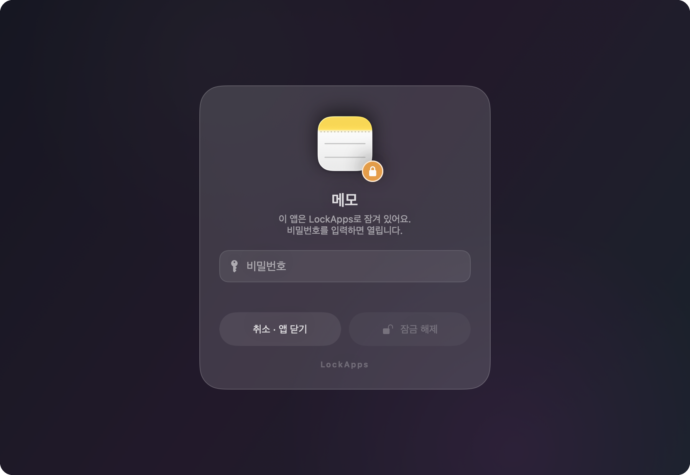
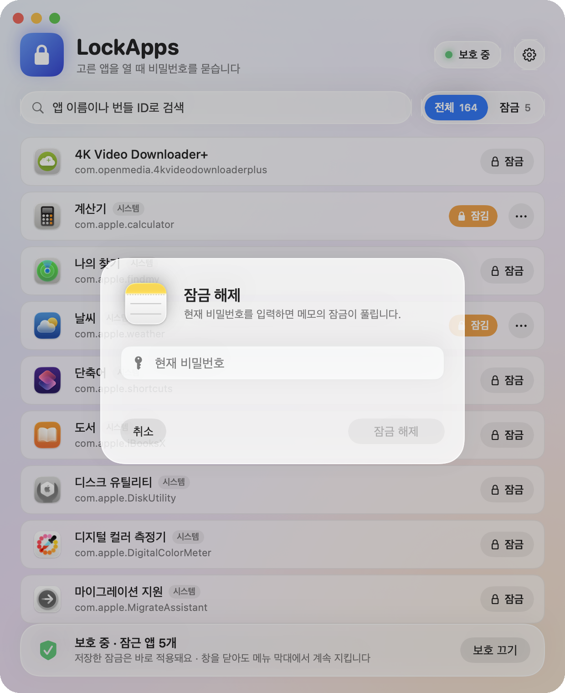
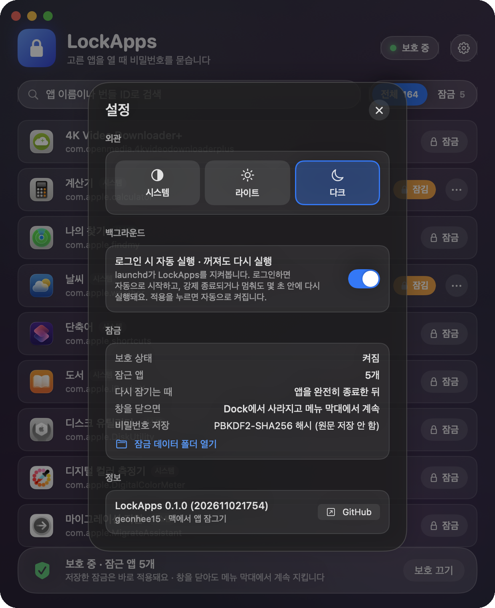
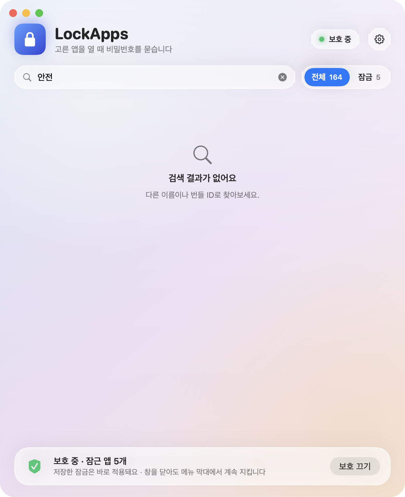
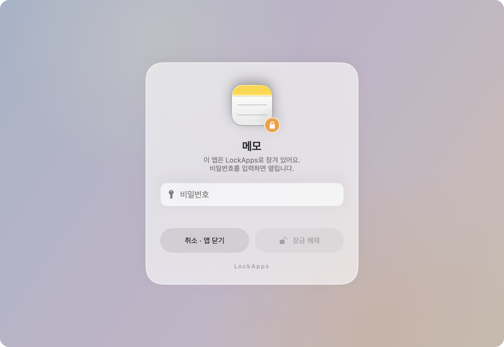

# LockApps — 맥 앱에 비밀번호 걸기

Mac에 설치된 앱 중 원하는 것을 골라 비밀번호를 걸어 두면, 그 앱을 열 때마다 비밀번호를 물어보고
맞아야만 열리는 작은 macOS 앱입니다. Xcode 없이 Command Line Tools만으로 빌드되고, 메뉴 막대에 조용히 상주합니다.

UI는 [ATFM](https://github.com/geonhee15/ATFM)의 유리(glass) 느낌만 가져왔습니다 — 뒤가 비치는 창, 반투명 카드,
macOS 26에서는 진짜 Liquid Glass(`glassEffect`) 컨트롤. 라이트 · 다크 · 시스템 모드를 앱 안에서 고를 수 있습니다.

## 스크린샷

<table>
  <tr>
    <td align="center"><br><b>메인 화면 · 라이트</b><br><sub>설치된 앱 전부 · 검색 · 잠금 상태 · 적용</sub></td>
    <td align="center"><br><b>메인 화면 · 다크</b><br><sub>같은 화면, 다크 모드</sub></td>
  </tr>
  <tr>
    <td align="center"><br><b>비밀번호 설정</b><br><sub>앱 옆 "잠금" → 비밀번호 · 확인 → 저장</sub></td>
    <td align="center"><br><b>잠근 앱만 보기</b><br><sub>⋯ 메뉴에서 비밀번호 변경 · 잠금 해제</sub></td>
  </tr>
  <tr>
    <td align="center" colspan="2"><br><b>잠긴 앱을 열면</b><br><sub>화면 전체가 흐려지고 유리 카드가 뜹니다 — 비밀번호가 맞아야 앱이 계속 열립니다 (틀리면 흔들림, 5번 틀리면 앱 종료)</sub></td>
  </tr>
  <tr>
    <td align="center"><br><b>잠금 해제</b><br><sub>현재 비밀번호를 알아야 풀 수 있음</sub></td>
    <td align="center"><br><b>설정</b><br><sub>외관(시스템/라이트/다크) · 로그인 시 자동 실행 · 저장 방식</sub></td>
  </tr>
  <tr>
    <td align="center"><br><b>검색</b><br><sub>앱 이름 · 번들 ID</sub></td>
    <td align="center"><br><b>잠금 해제 카드 · 라이트</b><br><sub>라이트 모드에서의 유리 카드</sub></td>
  </tr>
</table>

## 사용법

1. **LockApps를 열면** `/Applications` · `/System/Applications` · `~/Applications`(과 그 안의 Utilities, 하위 폴더 한 단계)에 있는
   앱이 전부 아이콘과 함께 나옵니다. 위 검색창에서 이름이나 번들 ID로 찾고, "전체 / 잠금" 칩으로 거릅니다.
2. 잠그고 싶은 앱 옆의 **잠금** 을 누르고 비밀번호를 두 번 입력해 **저장** 합니다 (4자 이상, 앱마다 다른 비밀번호 가능).
   잠긴 앱은 주황색 **잠김** 배지가 붙고, ⋯ 메뉴에서 **비밀번호 변경** · **잠금 해제** 를 할 수 있어요 — 둘 다 현재 비밀번호가 필요합니다.
3. 아래 바의 **적용** 을 누르면 보호가 켜집니다. 이때 **로그인 시 자동 실행** 도 함께 켜져서(설정에서 끌 수 있음) Mac을 다시 켠 뒤에도 동작합니다.
   보호가 켜진 뒤에 저장하는 잠금은 바로 적용돼요.
4. 이제 잠근 앱을 Dock · Finder · Spotlight · 터미널(`open -a`) 어디서 열든, 앱이 화면에 나타나기 전에 화면이 흐려지고
   비밀번호 카드가 뜹니다. 맞으면 앱이 그대로 이어서 열리고, **취소** 하거나 5번 틀리면 앱이 닫힙니다.
   한 번 풀어 둔 앱은 **완전히 종료할 때까지** 다시 묻지 않습니다.
5. 창을 닫으면 Dock에서 사라지고 **메뉴 막대(🔒)** 에만 남아 계속 지킵니다. 아이콘 메뉴에서 창 열기 · 보호 켜기/끄기 · 종료.
   보호 중에 ⌘Q를 누르면 "창만 닫기 / 보호 끄고 종료 / 취소"를 물어봅니다. 적용할 때 켜지는 **백그라운드 실행**(launchd 에이전트)
   덕분에 강제 종료 · 크래시 · `kill` 로 꺼져도 몇 초 안에 다시 실행되고, 로그인하면 창 없이 조용히 시작합니다.
   잠금을 정말 멈추려면 **보호 끄기** 를 누르세요.

## 어떻게 동작하나

- **감시**: `NSWorkspace`의 `willLaunch` / `didLaunch` / `didActivate` / `didTerminate` 알림과 `runningApplications` KVO로
  잠근 번들 ID의 프로세스를 지켜봅니다. 권한(손쉬운 사용·화면 기록 등)은 필요 없습니다.
- **막기**: 앱이 **막 실행되는 중**이면 첫 창을 그리기 전에 `SIGSTOP`으로 얼려 두고, 비밀번호가 맞으면 `SIGCONT`로 이어서 실행,
  취소하면 `SIGKILL`. 이미 **실행 중인 앱**(Dock에서 다시 눌렀거나, 켜 둔 채로 잠근 경우)은 숨기고(`hide`) 0.25초마다 다시 숨기다가
  맞으면 다시 보이게 하고(`unhide` + 활성화), 취소하면 종료합니다. 보호를 끄거나 LockApps가 종료될 때는 잡아 둔 앱을 모두 풀어 줍니다.
- **백그라운드**: 앱 안의 `Contents/Library/LaunchAgents/com.geonhee.lockapps.agent.plist` 를 `SMAppService.agent` 로 등록합니다
  (`RunAtLoad` + `KeepAlive.SuccessfulExit = false`, `ThrottleInterval` 2초). 로그인 때 launchd가 띄우고, 시그널로 죽거나 0이 아닌 코드로
  끝나면 다시 띄웁니다. 직접 더블클릭해 연 사본이 있는 채로 launchd 사본이 올라오면 분산 알림으로 **넘겨받고**(이전 사본은 잡고 있던 앱을
  풀어 주고 종료, 창이 열려 있었으면 새 사본이 다시 엶), 새로 시작한 사본은 `SIGSTOP` 상태로 남아 있는 잠근 앱을 찾아 다시 비밀번호를 묻습니다.
  로그아웃 · 종료 · 재시동 때의 종료 요청은 대화상자 없이 바로 따릅니다.
- **비밀번호**: 원문은 저장하지 않고 앱마다 무작위 솔트 + **PBKDF2-HMAC-SHA256 (150,000회)** 해시만
  `~/Library/Application Support/LockApps/locks.json`(0600)에 둡니다. 비교는 상수 시간으로.
  비밀번호를 잊으면 되찾을 방법은 없고, 이 파일을 지우면 모든 잠금이 초기화됩니다.
- **UI**: 창 배경은 `NSVisualEffectView`(behind-window) 위에 반투명 카드, 검색창 · 상태 칩 · 하단 바 · 비밀번호 카드는
  macOS 26에서 `glassEffect`(Liquid Glass), 그 아래 버전에선 `ultraThinMaterial` + 하이라이트 선. 외관은 `NSApp.appearance`로 앱 단위 전환.

## 알아 둘 것 (한계)

- 같은 사용자 계정의 터미널에서 멈춘 앱에 `kill -CONT` 를 보내거나, `launchctl bootout` 으로 에이전트를 내리거나, 앱 안의 **보호 끄기** 를
  누르면(마스터 비밀번호 없음) 우회할 수 있어요. 이 앱은 **가족·동료가 무심코 앱을 여는 것**을 막는 용도이지, 관리자 권한이 있는 사람을 막는
  보안 경계가 아닙니다. 그런 용도는 macOS 사용자 계정 분리 + FileVault가 맞습니다.
- Finder · Dock · Terminal · loginwindow 같은 앱은 목록에서 빼 두었습니다 (잠그면 세션이 꼬입니다).
- 앱을 아주 빨리 그리는 일부 앱은 `SIGSTOP` 전에 창이 한 프레임 보일 수 있습니다.
- 앱을 **끄지 않고** 다른 창으로 갔다 와도 다시 묻지 않습니다(세션 단위 해제). 다시 잠그려면 앱을 종료하세요.
- 백그라운드 실행(로그인 항목)을 macOS가 "허용 필요" 상태로 두면 설정 카드에 안내와 "시스템 설정 열기" 버튼이 뜹니다. 허용 전까지는
  LockApps가 떠 있는 동안만 잠금이 동작합니다.
- `~/Applications/LockApps.app` 경로를 에이전트가 가리키므로, 앱을 다른 곳으로 옮기면 설정에서 백그라운드 실행을 껐다 켜세요.

## 빌드

Xcode 없이 Command Line Tools만 있으면 됩니다 (macOS 14+, Swift 5.9+).

```bash
./build.sh          # build/LockApps.app 생성 + ~/Applications/LockApps.app 설치
./build.sh --run    # 빌드 후 실행
./build.sh debug    # 디버그 빌드 (build/ 에만)
```

`build.sh` 는 `swiftc` 로 소스를 통째로 컴파일한 뒤 `.app` 번들을 조립하고 서명합니다. 키체인에 코드 서명 인증서가 있으면
(`LOCKAPPS_SIGN_IDENTITY`, 기본값 `Omni Dev Signing`) 그걸로, 없으면 ad-hoc 서명합니다. 릴리즈 빌드는 **`~/Applications/LockApps.app`** 에
설치하고(`LOCKAPPS_INSTALL_DIR` 로 변경) 백그라운드 에이전트는 그 사본을 가리킵니다. 첫 빌드는 SDK 모듈 캐시(`build/ModuleCache`)를 만드느라
1~2분 걸리고, 그 다음부터는 수 초면 끝납니다. 아이콘(`AppIcon.icns`)은 `Scripts/make-icon.swift` 가 SF Symbol로 그려 냅니다.
Command Line Tools에 오래된 `module.modulemap` 이 남아 있어 `redefinition of module 'SwiftBridging'` 이 나는 Mac은
`Scripts/toolchain-fix` 의 VFS 오버레이로 자동 우회합니다.

### 개발용 환경 변수

`LOCKAPPS_DATA_DIR` 를 주면 "디버그 실행"이 됩니다: 잠금 데이터는 그 폴더에서 읽고 쓰고, 설정은 저장하지 않고,
잠금 엔진은 (`LOCKAPPS_DEBUG_ENGINE=1` 이 아니면) 켜지지 않습니다. README 스크린샷은 전부 이 조합으로 만듭니다 (`Scripts/screenshots.sh`).

| 변수 | 동작 |
|---|---|
| `LOCKAPPS_DATA_DIR=<dir>` | 디버그 실행. 잠금 파일을 이 폴더에서 읽고 씀, 설정 저장 안 함, 단일 실행 검사 생략 |
| `LOCKAPPS_DEBUG_SAMPLE_LOCKS=1` | 계산기 · 날씨 · 메모 · Safari · 메시지 · 사진이 있으면 비밀번호 `1234` 로 잠근 상태로 시작 |
| `LOCKAPPS_DEBUG_LOCK=<bundleID>[,<bundleID>]` | 지정한 앱을 `1234` 로 잠근 상태로 시작 |
| `LOCKAPPS_DEBUG_PROTECTION=1` · `LOCKAPPS_DEBUG_LOGIN_ITEM=1` | 보호 켜짐 · 로그인 항목 켜짐으로 **표시**만 (저장 안 함) |
| `LOCKAPPS_DEBUG_ENGINE=1` | 디버그 실행에서도 잠금 엔진을 켬 (엔드투엔드 테스트용) |
| `LOCKAPPS_DEBUG_AUTOTYPE=<pw>` | 비밀번호 카드가 뜨면 1초 뒤 그 비밀번호를 자동 입력 (엔드투엔드 테스트용) |
| `LOCKAPPS_APPEARANCE=light\|dark\|system` | 이 실행만 외관 강제 |
| `LOCKAPPS_DEBUG_SHEET=set:<bid>\|change:<bid>\|remove:<bid>\|settings` | 해당 카드를 연 채 시작 |
| `LOCKAPPS_DEBUG_FILTER=locked` · `LOCKAPPS_DEBUG_SEARCH=<글>` | 잠금 필터 · 검색어를 채운 채 시작 |
| `LOCKAPPS_DEBUG_PROMPT=<bundleID>` (+`_ERROR=1`) | 실제 앱 없이 잠금 해제 카드를 900×620 창으로 띄움 (비밀번호 `1234`) |
| `LOCKAPPS_SNAPSHOT=/path.png` · `LOCKAPPS_SNAPSHOT_PROMPT=/path.png` | 잠시 뒤 메인 창 · 잠금 해제 카드를 PNG로 저장하고 종료 (`LOCKAPPS_SNAPSHOT_EXIT=0` 이면 안 끔) |
| `LOCKAPPS_SNAPSHOT_DELAY=3` | 스냅샷까지 기다리는 초 (기본 2.5) |
| `LOCKAPPS_WINDOW_SIZE=620x760` | 메인 창 크기 |
| `LOCKAPPS_AGENT=1` | launchd 에이전트가 설정하는 값: 창 없이 메뉴 막대에서 시작하고, 직접 실행한 사본이 있으면 넘겨받음 |
| `LockApps --agent status\|register\|unregister` | 설치된 앱 번들 안의 실행 파일로 호출해 launchd 에이전트 상태를 보거나 등록/해제 |

스냅샷은 창을 오프스크린으로 그려서(`cacheDisplay`) 저장하므로 화면 기록 권한이 필요 없습니다. 대신 뒷창 블러와 Liquid Glass는
그렇게 그려지지 않아서, 스냅샷 실행(`LOCKAPPS_FLAT_GLASS=1` 과 같음)에서는 그려 넣은 배경화면 위에 반투명 면으로 대신합니다 —
실제 화면에서는 진짜 블러/유리가 보입니다.

엔드투엔드로 잠금이 되는지 보려면 (계산기를 잠그고, 열고, 자동으로 비밀번호를 넣어 봄):

```bash
D=$(mktemp -d); LOCKAPPS_DATA_DIR=$D LOCKAPPS_DEBUG_LOCK=com.apple.calculator LOCKAPPS_DEBUG_PROTECTION=1 \
  LOCKAPPS_DEBUG_ENGINE=1 LOCKAPPS_DEBUG_AUTOTYPE=1234 build/LockApps.app/Contents/MacOS/LockApps &
sleep 3; open -a Calculator          # 멈췄다가(ps 상태 T) 1초 뒤 비밀번호가 들어가며 열립니다
```

## 구조

```
Sources/LockApps
├── App/        진입점(LockAppsMain, --agent CLI), AppDelegate(창 · 메뉴 막대 · 단일 실행/넘겨받기 · 종료 흐름 · 디버그 플래그), 메인 메뉴, UIState
├── Apps/       InstalledApp 모델, AppScanner(앱 폴더 스캔), AppIconCache
├── Lock/       LockStore(locks.json), PasswordHasher(PBKDF2), LockEngine(감시 · SIGSTOP/hide · 큐), UnlockPromptWindow(NSPanel)
├── Support/    AppSettings(외관 · 보호 · SMAppService 백그라운드 에이전트), WindowSnapshot(오프스크린 렌더)
└── UI/         RootView(헤더 · 검색 · 목록 · 하단 바 · 오버레이), AppRow, PasswordSheet, SettingsSheet, UnlockPromptView, Theme, Glass
Scripts/        make-icon.swift(아이콘), screenshots.sh(README 스크린샷), toolchain-fix(CLT 우회)
Resources/      Info.plist, com.geonhee.lockapps.agent.plist (launchd 에이전트 정의)
```

## 라이선스

MIT — [LICENSE](LICENSE)
